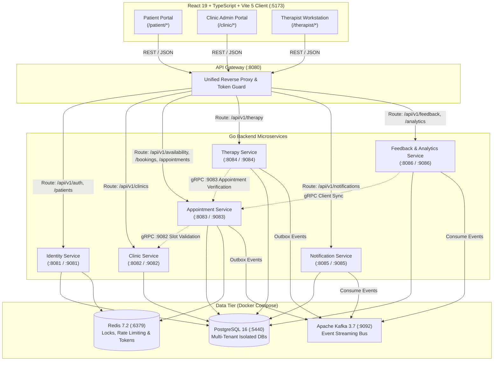

# Panchakarma Flow — Clinical Management & Therapy Delivery Platform

An enterprise-grade, distributed digital health platform engineered to coordinate, track, schedule, and audit multi-day traditional Ayurvedic Panchakarma clinical regimens.

---

## 1. System Topology & Architecture

The platform operates as a distributed microservice architecture adhering strictly to domain boundaries. No monolithic consolidation or mock data is used for functional claims.



---

## 2. Technology Stack

| Layer | Technologies | Responsibilities |
| :--- | :--- | :--- |
| **Edge Gateway** | Go 1.22+ / Gin, Reverse Proxy | Request routing, CORS, rate limiting, request tracing (`X-Trace-ID`). |
| **Microservices** | Go 1.22+ / Gin / gRPC | 7 microservices handling identity, clinics, bookings, sessions, notifications, and analytics. |
| **Persistence** | PostgreSQL 16 (Alpine) | Isolated database per service, native `btree_gist` exclusion constraints, transactional outbox. |
| **Caching & Locking** | Redis 7.2 (Alpine) | Tier-1 ephemeral 10-minute slot holds (`SET ... NX EX 600`), token revocation blacklist, rate limit sliding windows. |
| **Messaging** | Apache Kafka 3.7 (KRaft) | Asynchronous domain event streaming with zero ZooKeeper dependency; Kafka UI on port 8089. |
| **Frontend** | React 19, TypeScript, Vite 5, TailwindCSS | Portals for Patients, Clinic Administrators, and Therapists. Clean production build with 0 type errors. |

---

## 3. Quickstart & Local Deployment

> [!NOTE]
> **Zero Cloud Credentials Required**: Core development, authentication, scheduling, session logging, and analytics execute entirely against local Docker containers and localhost Go microservice binaries.

### Prerequisites
- **Go 1.22+**
- **Docker & Docker Compose** (v2+)
- **Node.js 20+**
- **Protocol Buffer Compiler (`protoc`)** with `protoc-gen-go` and `protoc-gen-go-grpc`
- **PowerShell 5.1+** (Windows) or **Bash 4+** (Linux / macOS)

### Step 1: Start Infrastructure (PostgreSQL, Redis, Kafka)
```powershell
# From the repository root:
docker compose up -d

# Verify all 4 containers report healthy:
docker compose ps
```
- PostgreSQL: `localhost:5440`
- Redis: `localhost:6379`
- Apache Kafka: `localhost:9092`
- Kafka UI: [http://localhost:8089](http://localhost:8089)

### Step 2: Compile Protocol Buffers (Reproducible)
```powershell
cd backend
.\scripts\gen_proto.ps1
cd ..
```

### Step 3: Run Backend Microservices
```powershell
# Starts all 7 microservices in background worker processes:
.\run-backend.ps1 -SkipInfra
```

### Step 4: Run Frontend Development Server
```powershell
cd frontend
npm install
npm run dev
```
Open [http://localhost:5173](http://localhost:5173) in your browser.

### Step 5: Stop Backend Services
```powershell
.\stop-backend.ps1
```

---

## 4. Verification & Testing

### Automated End-to-End Suite (33/33 Passed)
```powershell
powershell -ExecutionPolicy Bypass -File .\backend\scripts\test-phase9-e2e.ps1
```
Verified coverage:
- Gateway routing & 401 unauthenticated protection.
- Staff & patient authentication, token rotation, and invalid signature rejection.
- Clinic, doctor (BAMS / MD qualifications), and therapy package catalog browsing.
- Availability search & provisional 10-minute hold (`/bookings/hold`).
- **Simultaneous double-booking prevention under load (`409 Conflict`)**.
- Pre-procedure checklists and baseline vitals capture.
- Session completion, material tracking, and clinical audit reconciliation.
- Single-submission feedback rules (`409 Conflict` on duplicate).
- Adverse event reporting and clinical supervisor acknowledgment.
- Clinical analytics dashboard computing all 8 Phase 8 metrics + streaming CSV exports.
- Multi-tenant data isolation and cross-patient ID manipulation defense (`403 Forbidden`).
- Notification outage resilience.

### Go Package Tests
```powershell
cd backend
go test -v ./pkg/...
go test ./internal/services/...
```

### Frontend Production Build
```powershell
cd frontend
npm run build
```

---

## 5. Architectural & Governance Documentation Index

- [docs/local-development.md](file:///c:/panchakarma%20flow/docs/local-development.md): Detailed local developer setup, database provisioning, and troubleshooting.
- [docs/end-to-end-tests.md](file:///c:/panchakarma%20flow/docs/end-to-end-tests.md): Comprehensive test matrix, execution commands, and concurrency race assertions.
- [docs/security-audit.md](file:///c:/panchakarma%20flow/docs/security-audit.md): Security architecture audit (JWT, bcrypt, RBAC, tenant isolation, CORS, rate limiting).
- [docs/known-limitations.md](file:///c:/panchakarma%20flow/docs/known-limitations.md): Operational limitations, external credentials required for staging/prod, and deployment recommendations.
- [docs/openapi.yaml](file:///c:/panchakarma%20flow/docs/openapi.yaml): Unified OpenAPI 3.1.0 REST API Gateway specification.
- [docs/phase-9-integration-report.md](file:///c:/panchakarma%20flow/docs/phase-9-integration-report.md): Frontend integration and end-to-end testing verification report.
